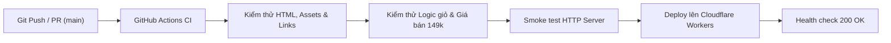

# 🕯️ Touchie Vietnam - Luxury Boutique Landing Page

[](https://github.com/taquangminh2277-commits/Touchie-VietNam/actions/workflows/ci-cd.yml)
[](https://touchie-vietnam.taquangminh2277.workers.dev)

Trang giới thiệu và bán nến thơm thực vật cao cấp chuẩn phong cách boutique (*The Candleholic style*) cho thương hiệu **Touchie Vietnam**.

- **Website chính thức:** [https://touchie-vietnam.taquangminh2277.workers.dev](https://touchie-vietnam.taquangminh2277.workers.dev)
- **Công nghệ:** HTML5, Tailwind CSS (CDN), Vanilla JavaScript, Cloudflare Workers (Static Assets).

---

## 🌟 Tính năng chính

- **Typography & Nhận diện thương hiệu retro 70s:** Logo uốn cong nghệ thuật, font chữ thanh lịch, tông màu hổ phách/terracotta/sand sang trọng.
- **Danh mục 3 mùi hương độc bản:**
  - **Warm Orange (100gr):** `149.000₫` *(Citrus & Amber)*
  - **Creamy Butter (100gr):** `149.000₫` *(Gourmand & Vanilla)*
  - **Orchid Veil (100gr):** `149.000₫` *(Floral & Sandalwood)*
- **Tháp 3 tầng hương chi tiết (Fragrance Pyramid):** Khám phá Top / Heart / Base notes.
- **Trợ lý chọn hương theo tâm trạng (Interactive Mood Matcher):** Tư vấn chọn mùi nến phù hợp theo trạng thái cảm xúc.
- **Set quà tặng The Signature Trio Giftset:** `399.000₫` kèm hộp quà cao cấp, diêm vintage và thiệp thảo mộc.
- **Giỏ hàng trượt (Cart Drawer) & Thanh tiến trình Freeship:** Tự động mở khóa Miễn phí vận chuyển khi đơn hàng từ 399.000₫.
- **Thanh toán nhanh VietQR:** Tự động sinh mã QR chuyển khoản chính xác theo từng đơn hàng.

---

## 🚀 Khởi chạy trên máy Local

Yêu cầu: [Node.js](https://nodejs.org/) v18 trở lên.

```bash
# 1. Chạy server phát triển cục bộ
npm start

# Mở trình duyệt truy cập:
# http://localhost:3333/
```

---

## 🧪 Kiểm thử tự động (Automated Verification)

Chạy bộ kiểm thử tự động kiểm tra toàn bộ 37 tiêu chí (tính toàn vẹn ảnh, liên kết, giá bán, logic giỏ hàng và server HTTP):

```bash
npm test
```

---

## 🔄 Quy trình CI/CD (GitHub Actions)

Hệ thống CI/CD được thiết lập tự động trong file `.github/workflows/ci-cd.yml`:



### 1. CI (Continuous Integration):
- Kích hoạt mỗi khi có `push` hoặc `pull_request` vào nhánh `main`.
- Kiểm tra tính hợp lệ của toàn bộ mã nguồn HTML5, meta tags, doctype.
- Kiểm tra mọi đường dẫn hình ảnh (`src/assets/images/*.png`) đảm bảo không có ảnh lỗi hoặc ảnh 0-byte.
- Kiểm tra các neo liên kết điều hướng (`#collections`, `#giftsets`, `#care-guide`, ...).
- Kiểm tra tính toàn vẹn mức giá (`149.000₫`, `399.000₫`, freeship).
- Khởi động HTTP server ảo và gửi request smoke test xác nhận trả về mã `200 OK`.

### 2. CD (Continuous Deployment):
- Sau khi bài kiểm tra CI vượt qua 100%, hệ thống tự động triển khai mã nguồn mới nhất lên môi trường Cloudflare Workers.
- Thực hiện kiểm tra sức khỏe (Health Check) trực tiếp trên đường link production `https://touchie-vietnam.taquangminh2277.workers.dev`.

---

## 📁 Cấu trúc thư mục

```
Touchie-VietNam/
├── .github/
│   └── workflows/
│       └── ci-cd.yml          # Kịch bản GitHub Actions CI/CD
├── scripts/
│   └── verify-site.mjs        # Bộ kiểm thử tự động (37 checks)
├── src/
│   └── assets/
│       └── images/            # Toàn bộ logo & ảnh chụp sản phẩm
├── index.html                 # Giao diện chính của website
├── server.mjs                 # Static web server cho môi trường phát triển
├── wrangler.jsonc             # Cấu hình Cloudflare Workers Static Assets
├── .assetsignore              # Danh sách loại trừ khi deploy Cloudflare
├── package.json               # Quản lý scripts (npm start, npm test)
└── README.md                  # Tài liệu dự án
```
