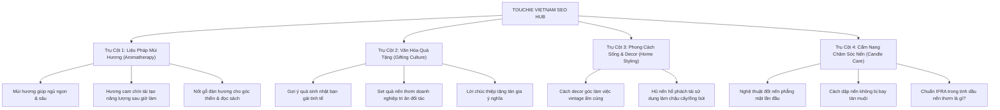

# 🕯️ CẨM NANG CHIẾN LƯỢC SEO TOÀN DIỆN - TOUCHIE VIETNAM
*(Chuyên gia SEO Bot & Content Master Blueprint)*

---

## 📌 1. ĐỊNH VỊ THƯƠNG HIỆU & CHÂN DUNG KHÁCH HÀNG (E-E-A-T)

- **Thương hiệu:** **Touchie Vietnam**
- **Định vị:** Artisanal Botanical Candles & Scent Gifting Boutique (Nến thơm thực vật thủ công & Quà tặng khứu giác cao cấp).
- **Triết lý sản phẩm:**
  - 100% sáp cọ & sáp đậu nành thiên nhiên (Plant-based wax).
  - Tinh dầu đạt chuẩn quốc tế IFRA an toàn cho trẻ nhỏ & thú cưng.
  - Bấc cotton thuần khiết, thời gian cháy sạch 15 giờ không lõm hố, không khói đen.
  - Hũ thủy tinh hổ phách (Amber glass) phong cách Retro Warmth 70s.
- **Sản phẩm & Mức giá:**
  - Hũ đơn 100gr: **149.000₫** (*Warm Orange*, *Creamy Butter*, *Orchid Veil*).
  - Combo 2 hũ: **279.000₫** (-19k).
  - The Signature Trio Giftset: **399.000₫** (Freeship toàn quốc, kèm hộp quà cứng, nơ lụa, diêm vintage, thiệp thảo mộc viết tay).

---

## 🎯 2. MA TRẬN TỪ KHÓA MỤC TIÊU (KEYWORD MATRIX & SEARCH INTENT)

### Nhóm 1: Từ Khóa Mua Hàng Siêu Tốc (Transactional Keywords)
| Từ khóa chính | Ý định tìm kiếm | Trang đích đề xuất |
| :--- | :--- | :--- |
| `nến thơm cao cấp giá tốt` | Mua hũ nến sang trọng giá hợp lý | `/index.html#collections` |
| `set quà tặng nến thơm` | Mua hộp quà nến thơm tặng người yêu/bạn bè | `/index.html#giftsets` |
| `mua nến thơm sáp đậu nành` | Mua nến sạch không paraffin an toàn | `/index.html#collections` |
| `quà tặng tân gia tinh tế` | Tìm quà tân gia sang trọng, ấm cúng | `/index.html#giftsets` |
| `nến thơm cam quế ấm áp` | Mua mùi hương Warm Orange | `/index.html#collections` |
| `nến thơm mùi bánh vani` | Mua mùi hương Creamy Butter | `/index.html#collections` |
| `nến thơm mùi gỗ đàn hương` | Mua mùi hương Orchid Veil | `/index.html#collections` |

### Nhóm 2: Từ Khóa Nghiên Cứu & Cân Nhắc (Commercial Keywords)
- `nến thơm sáp thực vật so với paraffin`
- `nến thơm nào an toàn cho phòng ngủ`
- `nến thơm tự nhiên có độc cho mèo không`
- `review nến thơm touchie vietnam`
- `top nến thơm thư giãn giảm stress tốt nhất`

### Nhóm 3: Từ Khóa Chia Sẻ Kiến Thức (Informational Keywords - Kéo Traffic Khủng)
- `cách đốt nến thơm không bị lõm hố (tunneling)`
- `tại sao nến thơm bị khói đen và cách khắc phục`
- `cắt bấc nến bao nhiêu cm là chuẩn nhất`
- `3 tầng hương nến thơm gồm những gì`
- `thắp nến thơm bao lâu thì tắt`

---

## 🌳 3. MÔ HÌNH TOPIC CLUSTERS (4 TRỤ CỘT NỘI DUNG)



---

## 📋 4. TIÊU CHUẨN VIẾT BÀI CHUẨN RANK MATH SEO 100/100

Mỗi bài viết hoặc mô tả sản phẩm do **Touchie SEO Bot** khởi tạo luôn tuân thủ nghiêm ngặt bảng kiểm định Rank Math:

1. **Từ khóa trọng tâm (Focus Keyword):**
   - Xuất hiện trong **SEO Title** (ngay 50% đầu tiêu đề).
   - Xuất hiện trong **Meta Description** (140 - 160 ký tự kèm lời kêu gọi hành động).
   - Xuất hiện trong **URL Slug** (ngắn gọn, không dấu, ngăn cách bằng dấu gạch ngang `-`).
   - Xuất hiện trong **10% đầu tiên** của bài viết (Đoạn Sapo).
   - Xuất hiện trong ít nhất một tiêu đề con **H2 hoặc H3**.
2. **Cấu trúc bài viết:**
   - Thẻ H1 duy nhất cho tiêu đề bài viết.
   - Thẻ H2 cho các luận điểm chính, H3 cho các ý bổ trợ.
   - Độ dài bài viết khuyến nghị: `1.200 - 1.800 từ` cho bài Pillar, `800 - 1.200 từ` cho bài Cluster.
3. **Mật độ từ khóa & LSI:**
   - Mật độ từ khóa chính: `1.0% - 1.5%` (tự nhiên, không nhồi nhét).
   - Đan xen các từ khóa ngữ nghĩa LSI: *sáp cọ, sáp đậu nành, tinh dầu IFRA, bấc cotton, hổ phách, quà tặng thủ công*.
4. **Hình ảnh & Đa phương tiện:**
   - Mọi hình ảnh đều có thẻ `alt` chứa từ khóa mô tả chi tiết:  
     *Ví dụ:* `alt="Hũ nến thơm Warm Orange 100gr từ sáp cọ tự nhiên Touchie Vietnam"`
5. **Liên kết (Internal & External Links):**
   - Tối thiểu 2 - 3 liên kết nội bộ (dẫn về sản phẩm liên quan hoặc set quà tặng).
   - 1 liên kết uy tín ra ngoài (ví dụ: chứng nhận an toàn IFRA quốc tế).

---

## 🧬 5. SCHEMA MARKUP JSON-LD MẪU CHO SẢN PHẨM & CỬA HÀNG

### A. Schema Sản Phẩm Nến Thơm (Product Schema)
```html
<script type="application/ld+json">
{
  "@context": "https://schema.org/",
  "@type": "Product",
  "name": "Nến Thơm Warm Orange 100gr - Touchie Vietnam",
  "image": "https://touchie-vietnam.taquangminh2277.workers.dev/src/assets/images/warm-orange.png",
  "description": "Nến thơm thủ công 100% sáp cọ tự nhiên, hương cam chín mọng, nhựa thông Siberi và hổ phách ấm áp.",
  "brand": {
    "@type": "Brand",
    "name": "Touchie Vietnam"
  },
  "offers": {
    "@type": "Offer",
    "url": "https://touchie-vietnam.taquangminh2277.workers.dev/#collections",
    "priceCurrency": "VND",
    "price": "149000",
    "availability": "https://schema.org/InStock"
  }
}
</script>
```

### B. Schema Hỏi Đáp Thường Gặp (FAQPage Schema)
```html
<script type="application/ld+json">
{
  "@context": "https://schema.org",
  "@type": "FAQPage",
  "mainEntity": [{
    "@type": "Question",
    "name": "Nến thơm Touchie Vietnam được làm từ chất liệu gì?",
    "acceptedAnswer": {
      "@type": "Answer",
      "text": "Touchie Vietnam sử dụng 100% sáp cọ và sáp đậu nành thực vật tự nhiên, tinh dầu đạt chuẩn an toàn IFRA quốc tế, hoàn toàn không chứa paraffin và không tạo khói độc."
    }
  }, {
    "@type": "Question",
    "name": "Hũ nến 100gr thắp được trong bao lâu?",
    "acceptedAnswer": {
      "@type": "Answer",
      "text": "Mỗi hũ nến hổ phách 100gr của Touchie có thời gian cháy sạch liên tục lên tới 15 giờ, độ tỏa hương tối ưu cho phòng diện tích từ 20 đến 35 mét vuông."
    }
  }]
}
</script>
```

---

## 🤖 6. CÁCH GỌI VÀ SỬ DỤNG "TOUCHIE SEO BOT" TRONG ANTIGRAVITY

Subagent **`touchie-seo-bot`** đã được cấu hình sẵn trong hệ thống. Anh có thể giao việc trực tiếp bất cứ lúc nào với các câu lệnh mẫu:

1. **Yêu cầu lập dàn ý & viết bài SEO:**
   > *"Viết cho anh một bài chuẩn Rank Math 100 điểm với từ khóa 'cách chọn nến thơm phòng ngủ giúp ngủ ngon'."*
2. **Yêu cầu tối ưu sản phẩm & thẻ Meta:**
   > *"Tối ưu lại tiêu đề SEO và Meta Description cho hũ Creamy Butter để tăng tỷ lệ nhấp CTR trên Google."*
3. **Yêu cầu nghiên cứu từ khóa theo mùa (Trend/Holiday):**
   > *"Lên danh sách 20 từ khóa tìm kiếm quà tặng nến thơm dịp 20/10, Giáng sinh và Valentine."*
4. **Yêu cầu tạo kịch bản Content Social (TikTok/Reels/Instagram SEO):**
   > *"Viết 3 kịch bản video ngắn 30s quay nến Warm Orange kèm hashtag SEO lên xu hướng."*
